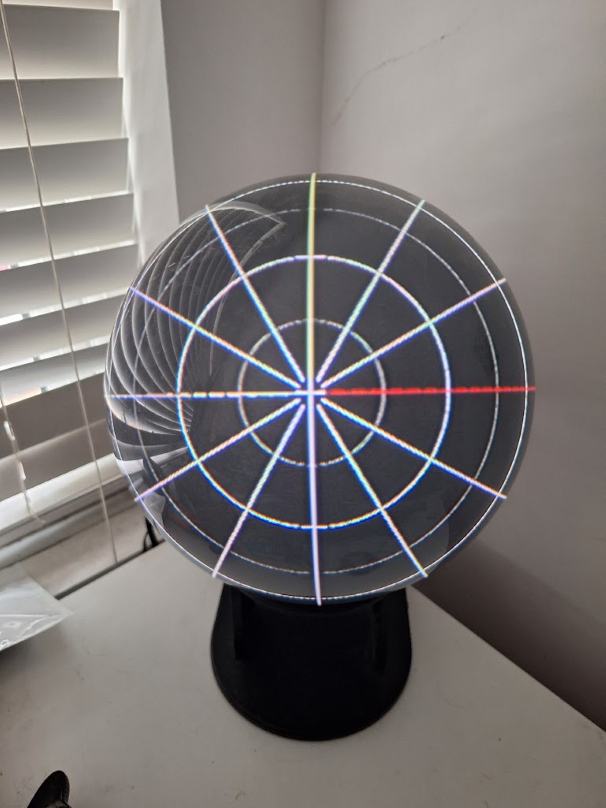

# Calibration and how it draws

Part of [Hemisphere](../README.md). Calibration is set once per WorldEye and saved in `calibration.cfg`. It is kept apart from every scene's look, so styling a scene can never knock it out.

To press keys while you calibrate, run Hemisphere in the foreground in an SSH session (see [adjusting settings](running.md#adjusting-settings)).



## The calibration grids

**Lens grid (G).** Rings round the centre of the dome every 15 degrees:
white at 30 and 60, yellow at 90 (the rim). Twelve spokes, with the **up**
spoke yellow and the **right** spoke red, and a small cross at the centre.

**Globe grid (B).** Lines of latitude and longitude, as a globe seen from
the front: yellow equator and front meridian, red back meridian.

**What "correct" looks like.** On the lens grid the rings should be round,
centred on the dome, and evenly spaced along the surface. Measure with a
strip of paper from the centre: centre to 30, 30 to 60 and 60 to the rim
should all match.

## Calibration workflow

Press **G** and TAB through the settings, in this order:

1. **centre_x, centre_y.** Put the centre cross in the middle of the dome.
2. **aspect.** Make the rings round.
3. **radius.** Put the yellow 90 degree ring on the rim of the dome.
4. **offset.** If the 30 and 60 rings are crowded towards the centre,
   increase it; if crowded towards the rim, decrease it. The rim won't move.
5. **ring30, ring60.** Nudge either ring if it's still a little off.
6. **turn.** Rotate until the yellow spoke points straight up. If the red
   spoke is on the left, press **X** to mirror.
7. **cutoff.** Raise it until nothing is drawn past the rim. 90 is right
   for a true half globe.
8. **T** spins the lens grid: the rings should stay still.
9. **B** for the globe grid: check the equator is level.
10. **S** to save, then **1** for the Death Star. Set `pitch` first, to put
    the pole at the top of the globe (pause with SPACE to judge it).

## How it draws

Every scene can draw two ways, and the Death Star uses both.

**Surface (full colour).** The scene writes one GLSL function:

```glsl
vec4 surface(vec3 dir, vec3 view)
```

`dir` is the point on the globe in the model's own coordinates (it turns
as the model spins; +Y is north). `view` is the same point fixed to the
globe on your desk (+Z out of the front, +Y up), for lighting. The core
runs this once for every pixel of the dome, so every pixel is filled:
solid planets, gradients, textures.

**Points.** Dots placed on the unit sphere, or recessed into it, mapped
onto the dome one by one. Use them for crisp lines, grids and overlays on
top of a surface.

### The lens maths

The projector's fisheye lens points straight out of the front of the dome.
For a point at angle phi from the dome's centre (0 at the centre, 90 at the
rim) and direction theta round it, the image radius is:

```
alpha(phi) = atan2(sin(phi), cos(phi) + offset)
rho(phi)   = radius * alpha(phi) / alpha(90 deg) * corr(phi)
```

`offset` is how far the lens sits behind the centre of the globe (0 means
at the centre), `radius` is where the rim lands on screen, and `corr` is
the ring30/ring60 fine correction.

Points use this forwards in the vertex shader. Surfaces need it backwards:
for this pixel, which point of the dome is it? The core tabulates
`rho(phi)`, inverts the table, and bakes the answer for every pixel into a
lookup texture whenever the calibration changes. Scenes never see the lens,
and dots and colour line up exactly because both come from the same
numbers. Press **O** in any scene to draw the globe grid over it and check.

The surface is rendered at `res` pixels across (640 by default) and
stretched onto the screen. That keeps the Pi 3 fast; raise `res` for a
sharper image if the frame rate holds up (`DOME_FPS=1 ./hemisphere` prints
it every ten seconds).
